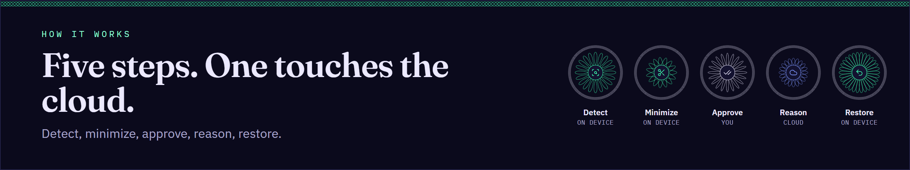
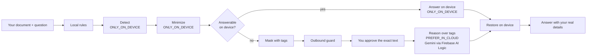

<p align="center">
  
</p>

<p align="center">
  <a href="https://envoy-hybrid-ai.web.app"><b>Open Envoy</b></a> &nbsp;·&nbsp;
  <a href="https://envoy-hybrid-ai.web.app/app?sample=lease">Two-minute test for judges</a> &nbsp;·&nbsp;
  <a href="#how-envoy-uses-firebase-ai-logic">Hybrid inference</a> &nbsp;·&nbsp;
  <a href="#the-guard">The guard</a> &nbsp;·&nbsp;
  <a href="docs/MEASUREMENT.md">How it's measured</a>
</p>

# Envoy

**Ask the cloud. Keep your secrets.** Envoy is your private agent to cloud AI. Before anything leaves your computer, AI on your own device reads your document and your question, keeps only what the question needs, and swaps every personal detail for a tag that keeps its meaning (`[LANDLORD]`, `[RENT]`). You see the exact text and approve it. Gemini in the cloud reasons over the tags, and your real details go back into the answer on your device.

This is **Privacy-Conscious Delegation** (after PAPILLON, Li et al., NAACL 2025), built on **Firebase AI Logic hybrid inference**: the on-device model handles everything private, and the cloud model handles the hard reasoning, over tags.

- **Try it:** [envoy-hybrid-ai.web.app](https://envoy-hybrid-ai.web.app) works in any desktop Chrome. With Chrome's on-device model you get Private mode. Without it, Envoy says so, uses Basic protection (local rules), and still never sends a raw detail it can detect.
- **Built for:** Firebase #BuildHybridAI 2026. Open source under Apache-2.0.


## What you see


Envoy works like any AI chat app: ask with a document or without one, attach a PDF, drop or paste a file, and follow up. The difference is what each answer carries:

- **A privacy flight recorder.** Every step, where it ran (this device, you, or the cloud), which model, how long it took, and how many characters left. It's filled from the pipeline's own step records, not a script.
- **An approval card.** The exact text the cloud will receive, with every detail already a tag. Share a value, hide a sentence, edit it, or stop. Nothing is sent until you approve.
- **The answer, restored on your device.** Values restored locally are highlighted in green. Maths like `{{RENT * 1.10}}` is done on your device, so the cloud never sees the result either.


You can also turn on **Local only** (answer on this device, no cloud call), add **your own rules** (words only you know are private; they stay in your browser), and open the **network ledger** to watch every request.



## How it works

| Step | What happens | Where it runs | Firebase AI Logic mode |
| --- | --- | --- | --- |
| 1. Detect | Rules catch IDs, phones, IBANs, cards, amounts, emails, dates and API keys. The on-device model finds names, roles and amounts the rules can't know. | This device | `ONLY_ON_DEVICE` |
| 2. Minimize | The on-device model picks the clauses that answer the question; the rest stays behind. | This device | `ONLY_ON_DEVICE` |
| 3. Approve | You read the excerpt word for word, with every detail as a tag, and approve, edit or stop. | You | none |
| 4. Reason | Gemini answers over tags and writes maths as expressions instead of guessing numbers. | Cloud | `PREFER_IN_CLOUD` |
| 5. Restore | Tags become your real details again; expressions are evaluated locally. | This device | none |

When a question can be answered from the document alone ("When does my lease end?"), the on-device model answers it and **nothing is sent at all**.




## How Envoy uses Firebase AI Logic

Each pipeline step gets its own model with a deliberate inference mode ([`packages/ai/src/models.ts`](packages/ai/src/models.ts)):

```ts
/** Private steps never leave the device; only `reason` may use the cloud. */
export function modeFor(step: Step): InferenceMode {
  return step === 'reason' ? InferenceMode.PREFER_IN_CLOUD : InferenceMode.ONLY_ON_DEVICE;
}

export function createStepModel(ai: AI, step: Step, settings: RemoteSettings, schema?: JsonSchema): GenerativeModel {
  const params: HybridParams = {
    mode: modeFor(step),
    inCloudParams: {
      model: settings.cloudModel, // from Remote Config
      ...(schema ? { generationConfig: { responseMimeType: 'application/json', responseJsonSchema: schema } } : {}),
    },
    onDeviceParams: {
      createOptions: { expectedInputs: ENGLISH_TEXT, expectedOutputs: ENGLISH_TEXT, initialPrompts: [/* the step's system prompt */] },
      ...(schema ? { promptOptions: { responseConstraint: schema } } : {}),
    },
  };
  return getGenerativeModel(ai, params);
}
```

- **Structured output on both sides:** on-device steps use `responseConstraint` and the cloud uses `responseJsonSchema`, with the same schema, so either side returns parseable JSON.
- **App Check** (reCAPTCHA Enterprise) protects the cloud calls. **Remote Config** picks the cloud model without a redeploy.
- **The on-device model download** starts from a click (`initializeDeviceModel` needs a user gesture), with progress in the app.
- **Every result names its source:** `response.inferenceSource` is checked on every call and shown in the flight recorder.

Five models, four on the device and one for the cloud, and where each piece lives:

| What | Code |
| --- | --- |
| `getAI` with App Check limited-use tokens | [`firebase.ts:44`](packages/ai/src/firebase.ts#L44) |
| The mode per step: `detect`, `minimize`, `route`, `answerLocal` use `ONLY_ON_DEVICE`; `reason` uses `PREFER_IN_CLOUD` | [`models.ts:22`](packages/ai/src/models.ts#L22), [`models.ts:27`](packages/ai/src/models.ts#L27) |
| Remote Config: `cloud_model`, `prompt_version` | [`remote.ts:20`](packages/ai/src/remote.ts#L20) |
| On-device model download from a click (`initializeDeviceModel`) | [`useEnvoy.ts:91`](apps/web/src/app/useEnvoy.ts#L91) |
| The device guard: availability check, network tripwire, `inferenceSource` assertion | [`device-guard.ts:78`](packages/ai/src/device-guard.ts#L78), [`:104`](packages/ai/src/device-guard.ts#L104), [`:131`](packages/ai/src/device-guard.ts#L131), [`:140`](packages/ai/src/device-guard.ts#L140) |
| The pipeline: `analyze` (private steps), `answer` (local answer or cloud reasoning over tags) | [`pipeline.ts:177`](packages/ai/src/pipeline.ts#L177), [`:304`](packages/ai/src/pipeline.ts#L304), [`:329`](packages/ai/src/pipeline.ts#L329) |

To see the guard catch firebase-js-sdk #10635 yourself, open [`/dev`](https://envoy-hybrid-ai.web.app/dev) and press **Simulate missing LanguageModel**: the private step is blocked instead of silently going to the cloud.

### Why not just redact?

A typical scrubber replaces everything with `[REDACTED]` and still sends the whole document. The cloud loses who is who, and gets far more than it needs. Envoy delegates instead:

- **Tags keep meaning.** Karim Fathy becomes `[LANDLORD]` and EGP 8,500 becomes `[RENT]`, so the cloud can still reason about who owes what.
- **Only what the question needs is sent.** For the rent question, the on-device model keeps the rent clause; the clause with the bank account never leaves.
- **The cloud never sees the result either.** It writes `{{RENT * 1.10}}` and Envoy works out EGP 9,350 on your device ([`expr.ts`](packages/core/src/expr.ts)).
- **Some questions never go to the cloud.** "When does my lease end?" is answered on the device, with 0 bytes sent.


## The guard

`ONLY_ON_DEVICE` can silently call the cloud when Chrome's `LanguageModel` API is missing ([firebase-js-sdk #10635](https://github.com/firebase/firebase-js-sdk/issues/10635), open). A privacy product can't rely on that, so every private step goes through [`runPrivate`](packages/ai/src/device-guard.ts):

1. **Check first:** `LanguageModel` must exist and report `available`, or Envoy switches to Basic protection.
2. **Fence the network:** while a private step runs, any request to the Firebase AI endpoint is blocked, and the run stops with a privacy error instead of falling back.
3. **Verify after:** the response must report `inferenceSource === ON_DEVICE`, or its result is discarded.
4. **Clean up:** every on-device session is destroyed after its step.

Then, before anything is sent, the **outbound guard** ([`packages/core/src/guard.ts`](packages/core/src/guard.ts)) scans the approved text again for any raw value, spaced, punctuated or retyped by hand. Secrets (API keys, private keys, tokens) and your own rules count too. Anything raw blocks the send.

## Designed with Google's People + AI Guidebook

Envoy follows the [PAIR Guidebook](https://pair.withgoogle.com/guidebook) (full mapping in [docs/PAIR_GUIDEBOOK_STRATEGY.md](docs/PAIR_GUIDEBOOK_STRATEGY.md)). Its **interaction design policies** are enforced in code, not left to prompts:

1. **No silent cloud fallback.** A private step runs on the device or not at all ([`device-guard.ts`](packages/ai/src/device-guard.ts)).
2. **No raw detail leaves.** The outbound guard re-checks everything you approve, including your own edits ([`guard.ts`](packages/core/src/guard.ts)).
3. **No invented details.** A detail the on-device model reports only counts if it appears word for word in your document ([`prompts.ts`](packages/core/src/prompts.ts)).
4. **Explain, don't overclaim.** The on-device model's own reasons for what it kept and where it answers appear in the flight recorder. Envoy explains documents; it isn't legal advice.

The guidebook's patterns show up throughout: **let users supervise automation** (nothing is sent before you approve the exact text), **automate more when risk is low** (questions the document answers are answered on the device, with no approval needed because nothing leaves), **make it safe to explore** (a fictional sample contract), and **be transparent about privacy** (the flight recorder and the network ledger).


## Measured

Every number names the model, its version, the date and the number of cases, and comes from real runs of the real pipeline (`analyze` and `answer` through Firebase AI Logic). The eval harness measures masking, leaks after the guard, a re-identification attack on what actually leaves the device, and answer quality compared with sending the whole document. What every commit checks, and how the real-model evaluation works: [docs/MEASUREMENT.md](docs/MEASUREMENT.md).

A note on models: neither Firebase AI Logic nor the Prompt API reports which on-device model Chrome used. Our development runs used Gemma 4 (`gemma4_component`, behind a developer-trial flag). Ordinary Chrome uses its default Gemini Nano, and the results are reported for each.


## Judges: a two-minute test

1. Open [envoy-hybrid-ai.web.app/app?sample=lease](https://envoy-hybrid-ai.web.app/app?sample=lease). The sample lease and everyone in it are fictional.
2. Ask *"Can my landlord raise the rent 20% this year?"* and watch the flight recorder: each step says where it ran.
3. Read **What the cloud will see**. Names, IDs, the IBAN and the rent are tags. Share or hide something, then approve.
4. The answer comes back with your real numbers, restored in green. Add `?inspect=1` to the address to open the network ledger.

Private mode needs a desktop Chrome with the built-in model (check `chrome://on-device-internals`); Envoy offers the download from a click. Without it, everything above still works in Basic protection, and the app says which mode ran.

## Run it yourself

```sh
git clone https://github.com/hesham88/envoy && cd envoy
npm install
cp apps/web/.env.example apps/web/.env.local   # add your Firebase web config
npm run dev                                     # http://localhost:5173
npm run verify                                  # lint, typecheck, tests, build
```

| Path | What it is |
| --- | --- |
| [`packages/core`](packages/core) | The privacy engine, pure TypeScript with no network: rules, secrets, your own rules, tags, the outbound guard, expressions, restore, receipts. |
| [`packages/ai`](packages/ai) | Firebase AI Logic: per-step hybrid models, the device guard, the pipeline (`analyze`, `answer`). |
| [`packages/ui`](packages/ui) | Envoy's design system: tokens, the seal, guilloche art, the 2.5D scene, the UV ring, security fibres. |
| [`apps/web`](apps/web) | The web app: landing page, chat, flight recorder, approval. |
| [`apps/extension`](apps/extension) | The Chrome extension. |
| [`tests/eval`](tests/eval) | The eval harness. |


## Credits and licence

Inspired by **PAPILLON: Privacy Preservation from Internet-based and Local Language Model Ensembles** (Siyan Li et al., NAACL 2025), and designed with Google PAIR's **People + AI Guidebook**. Built with Firebase AI Logic, Chrome's built-in AI, Firebase App Check, Remote Config and Hosting. All sample people, IDs and numbers are fictional.

Licensed under [Apache-2.0](LICENSE).
