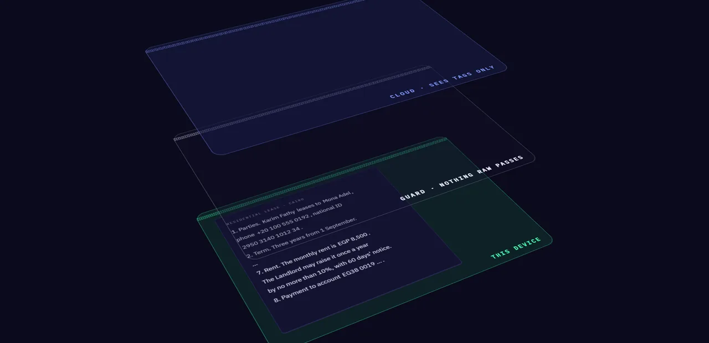
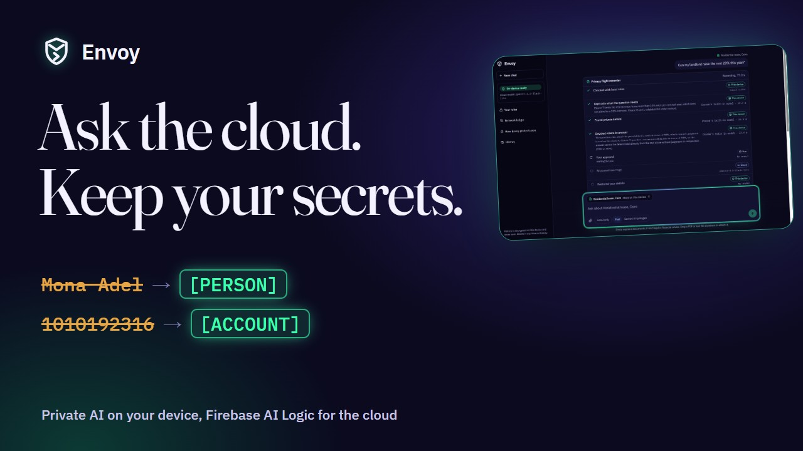
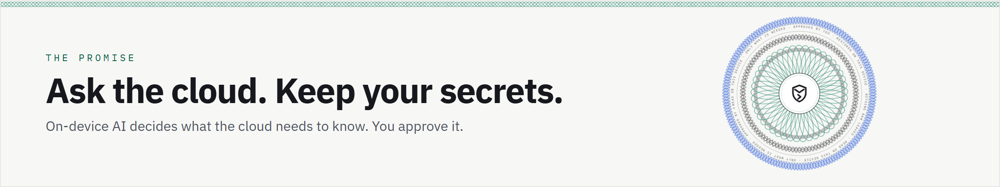
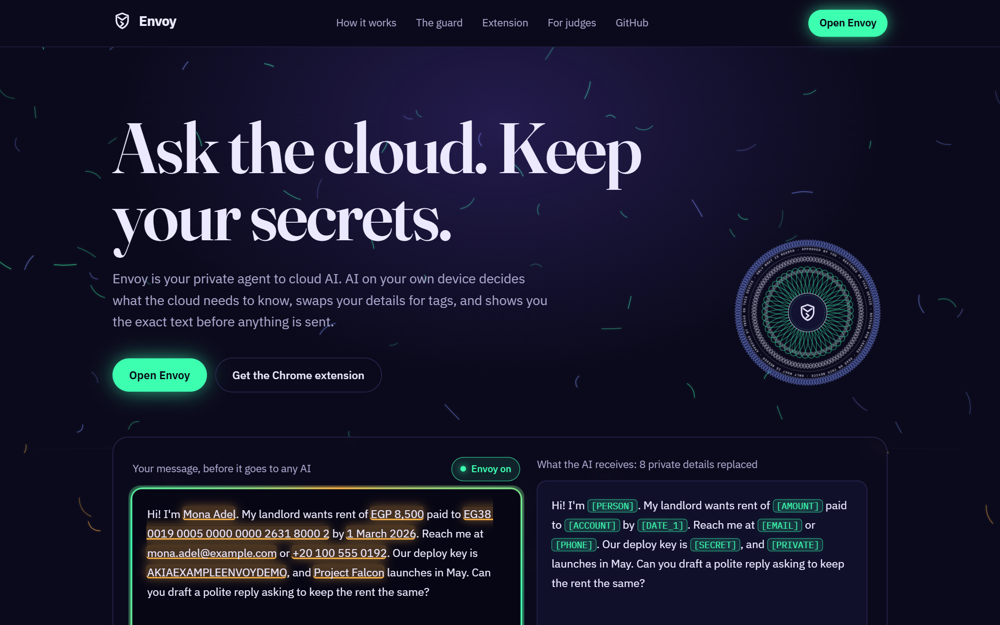
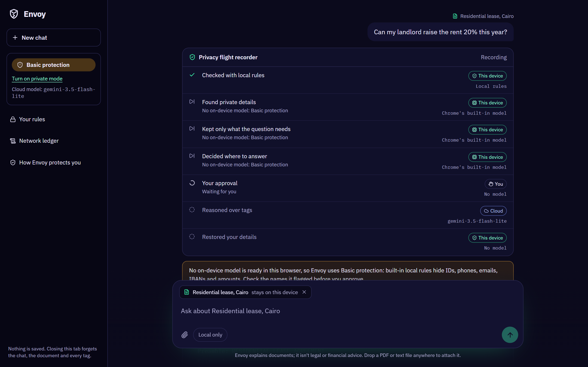
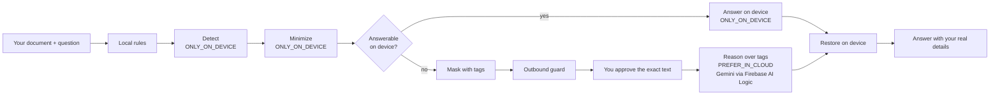
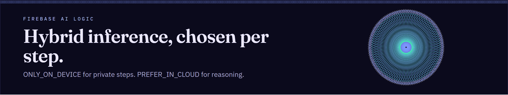
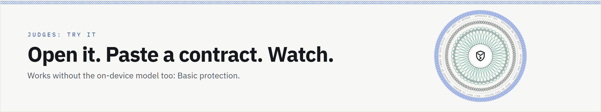
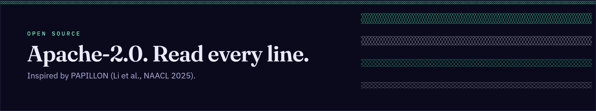

<p align="center">
  
</p>

<p align="center">
  <a href="https://envoy-hybrid-ai.web.app"><b>Open Envoy</b></a> &nbsp;·&nbsp;
  <a href="https://www.youtube.com/watch?v=ZO1DbGUI4Mk"><b>Watch the demo (2:58)</b></a> &nbsp;·&nbsp;
  <a href="#judges-a-two-minute-test">Two-minute test for judges</a> &nbsp;·&nbsp;
  <a href="#how-envoy-uses-firebase-ai-logic">Hybrid inference</a> &nbsp;·&nbsp;
  <a href="#the-guard">The guard</a> &nbsp;·&nbsp;
  <a href="docs/MEASUREMENT.md">How it's measured</a>
</p>

<p align="center">
  <a href="https://www.youtube.com/watch?v=ZO1DbGUI4Mk"></a>
</p>

# Envoy

**Ask the cloud. Keep your secrets.** Powerful AI reasoning, minimum necessary disclosure, and you stay in control. Envoy is your private agent to cloud AI. Before anything leaves your computer, AI on your own device reads your document and your question, keeps only what the question needs, and swaps every personal detail for a tag that keeps its meaning (`[LANDLORD]`, `[RENT]`). You see the exact text and approve it. Gemini in the cloud reasons over the tags, and your real details go back into the answer on your device.

This is **Privacy-Conscious Delegation** (after PAPILLON, Li et al., NAACL 2025), built on **Firebase AI Logic hybrid inference**: the on-device model handles everything private, and the cloud model handles the hard reasoning, over tags.

- **Try it:** [envoy-hybrid-ai.web.app](https://envoy-hybrid-ai.web.app) works in any desktop Chrome. With Chrome's on-device model you get Private mode. Without it, Envoy says so, uses Basic protection (local rules), and still never sends a raw detail it can detect.
- **Built for:** Firebase #BuildHybridAI 2026. Open source under Apache-2.0.



## What you see



Envoy works like any AI chat app: ask with a document or without one, attach a PDF, drop or paste a file, and follow up. The difference is what each answer carries:

- **A privacy flight recorder.** Every step, where it ran (this device, you, or the cloud), which model, how long it took, and how many characters left. It's filled from the pipeline's own step records, not a script.
- **An approval card.** The exact text the cloud will receive, with every detail already a tag. Share a value, hide a sentence, edit it, or stop. Nothing is sent until you approve.
- **The answer, restored on your device.** Values restored locally are highlighted in green. Maths like `{{RENT * 1.10}}` is done on your device, so the cloud never sees the result either.



You can also turn on **Local only** (answer on this device, no cloud call), add **your own rules** (words only you know are private; they stay in your browser), and open the **network ledger** to watch every request.


## How it works

| Step        | What happens                                                                                                                                         | Where it runs | Firebase AI Logic mode |
| ----------- | ---------------------------------------------------------------------------------------------------------------------------------------------------- | ------------- | ---------------------- |
| 1. Detect   | Rules catch IDs, phones, IBANs, cards, amounts, emails, dates and API keys. The on-device model finds names, roles and amounts the rules can't know. | This device   | `ONLY_ON_DEVICE`       |
| 2. Minimize | The on-device model picks the clauses that answer the question; the rest stays behind.                                                               | This device   | `ONLY_ON_DEVICE`       |
| 3. Approve  | You read the excerpt word for word, with every detail as a tag, and approve, edit or stop.                                                           | You           | none                   |
| 4. Reason   | Gemini answers over tags and writes maths as expressions instead of guessing numbers.                                                                | Cloud         | `PREFER_IN_CLOUD`      |
| 5. Restore  | Tags become your real details again; expressions are evaluated locally.                                                                              | This device   | none                   |

When a question can be answered from the document alone ("When does my lease end?"), the on-device model answers it and **nothing is sent at all**.





## How Envoy uses Firebase AI Logic

Each pipeline step gets its own model with a deliberate inference mode ([`packages/ai/src/models.ts`](packages/ai/src/models.ts)):

```ts
/** Private steps never leave the device; only `reason` may use the cloud. */
export function modeFor(step: Step): InferenceMode {
  return step === 'reason' ? InferenceMode.PREFER_IN_CLOUD : InferenceMode.ONLY_ON_DEVICE;
}

export function createStepModel(
  ai: AI,
  step: Step,
  settings: RemoteSettings,
  schema?: JsonSchema,
): GenerativeModel {
  const params: HybridParams = {
    mode: modeFor(step),
    inCloudParams: {
      model: settings.cloudModel, // from Remote Config
      ...(schema
        ? { generationConfig: { responseMimeType: 'application/json', responseJsonSchema: schema } }
        : {}),
    },
    onDeviceParams: {
      createOptions: {
        expectedInputs: ENGLISH_TEXT,
        expectedOutputs: ENGLISH_TEXT,
        initialPrompts: [/* the step's system prompt */],
      },
      ...(schema ? { promptOptions: { responseConstraint: schema } } : {}),
    },
  };
  return getGenerativeModel(ai, params);
}
```

- **Structured output on both sides:** on-device steps use `responseConstraint` and the cloud uses `responseJsonSchema`, with the same schema, so either side returns parseable JSON.
- **App Check** (reCAPTCHA Enterprise) protects the cloud calls. **Remote Config** picks the cloud model without a redeploy.
- **The on-device model download** starts from a click (`initializeDeviceModel` needs a user gesture), with progress in the app.
- **Every result names its source:** `response.inferenceSource` is checked on every call and shown in the flight recorder.

Five task-specific model configurations (four use Chrome's on-device model, one uses cloud reasoning), and where each piece lives:

| What                                                                                                                  | Code                                                                                                                                                                                                                                                     |
| --------------------------------------------------------------------------------------------------------------------- | -------------------------------------------------------------------------------------------------------------------------------------------------------------------------------------------------------------------------------------------------------- |
| `getAI` with App Check limited-use tokens                                                                             | [`getAI`](packages/ai/src/firebase.ts#L75)                                                                                                                                                                                                               |
| The mode per step: `detect`, `minimize`, `route`, `answerLocal` use `ONLY_ON_DEVICE`; `reason` uses `PREFER_IN_CLOUD` | [`modeFor`](packages/ai/src/models.ts#L33), [`createStepModel`](packages/ai/src/models.ts#L38)                                                                                                                                                           |
| Remote Config: `cloud_model`, `cloud_model_fast`, `cloud_default`, `prompt_version`                                   | [`getValue(rc, 'cloud_model')`](packages/ai/src/remote.ts#L79)                                                                                                                                                                                           |
| On-device model download from a click (`initializeDeviceModel`)                                                       | [`initializeDeviceModel`](packages/app/src/app/useEnvoy.ts#L142)                                                                                                                                                                                         |
| The device guard: availability check, network tripwire, `inferenceSource` assertion, session cleanup                  | [`getDeviceStatus`](packages/ai/src/device-guard.ts#L100), [`withCloudTripwire`](packages/ai/src/device-guard.ts#L131), [`InferenceSource.ON_DEVICE`](packages/ai/src/device-guard.ts#L210), [`withSessionCleanup`](packages/ai/src/device-guard.ts#L62) |
| The pipeline: `analyze` (private steps), `answer` (local answer or cloud reasoning over tags)                         | [`analyze`](packages/ai/src/pipeline.ts#L229), [`answer`](packages/ai/src/pipeline.ts#L439), [`checkOutbound`](packages/ai/src/pipeline.ts#L208)                                                                                                         |

To see the guard handle the case described in firebase-js-sdk #10635, open [`/dev`](https://envoy-hybrid-ai.web.app/dev) and press **Simulate missing LanguageModel**: the private step is blocked before any call is made.

### Why not just redact?

A typical scrubber replaces everything with `[REDACTED]` and still sends the whole document. The cloud loses who is who, and gets far more than it needs. Envoy delegates instead:

- **Tags keep meaning.** Karim Fathy becomes `[LANDLORD]` and EGP 8,500 becomes `[RENT]`, so the cloud can still reason about who owes what.
- **Only what the question needs is sent.** For the rent question, the on-device model keeps the rent clause; the clause with the bank account isn't sent.
- **The cloud never sees the result either.** It writes `{{RENT * 1.10}}` and Envoy works out EGP 9,350 on your device ([`expr.ts`](packages/core/src/expr.ts)).
- **Some questions never go to the cloud.** "When does my lease end?" is answered on the device, with 0 bytes sent.


## The guard

An open report on the Firebase JS SDK ([firebase-js-sdk #10635](https://github.com/firebase/firebase-js-sdk/issues/10635)) describes `ONLY_ON_DEVICE` requests reaching the cloud when Chrome's `LanguageModel` API is missing. We haven't run into it ourselves, but a privacy promise shouldn't rest on any one layer, so every private step goes through [`runPrivate`](packages/ai/src/device-guard.ts):

1. **Check first:** `LanguageModel` must exist and report `available`, or Envoy switches to Basic protection.
2. **Fence the network:** while a private step runs, any request to the Firebase AI endpoint is blocked, and the run stops with a privacy error instead of falling back.
3. **Verify after:** the response must report `inferenceSource === ON_DEVICE`, or its result is discarded.
4. **Clean up:** every on-device session is destroyed after its step.

Then, before anything is sent, the **outbound guard** ([`packages/core/src/guard.ts`](packages/core/src/guard.ts)) scans the approved text again for any raw value, spaced, punctuated or retyped by hand. Secrets (API keys, private keys, tokens) and your own rules count too. Anything raw blocks the send.

## Designed with Google's People + AI Guidebook

Envoy follows the [PAIR Guidebook](https://pair.withgoogle.com/guidebook) (full mapping in [docs/PAIR_GUIDEBOOK_STRATEGY.md](docs/PAIR_GUIDEBOOK_STRATEGY.md)). Its **interaction design policies** are enforced in code, not left to prompts:

1. **No silent cloud fallback.** A private step runs on the device or not at all ([`device-guard.ts`](packages/ai/src/device-guard.ts)).
2. **No raw detail leaves.** The outbound guard re-checks everything you approve, including your own edits ([`guard.ts`](packages/core/src/guard.ts)).
3. **No invented details.** A detail the on-device model reports only counts if it appears word for word in your document ([`prompts.ts`](packages/core/src/prompts.ts)).
4. **Explain, don't overclaim.** The on-device model's own reasons for what it kept and where it answers appear in the flight recorder. Envoy explains documents; it isn't legal advice.

The guidebook's patterns show up throughout: **let users supervise automation** (nothing is sent before you approve the exact text), **automate more when risk is low** (questions the document answers are answered on the device, with no approval needed because nothing leaves), **make it safe to explore** (a fictional sample contract), and **be transparent about privacy** (the flight recorder and the network ledger).


## Measured

Real runs of the real pipeline (`analyze` and `answer` through Firebase AI Logic) on 36 test documents and questions, 263 private details in all, on a 2018 laptop CPU: Gemma 4 measured 24 November 2026 on the current pipeline, Basic protection 23 November. **Times vary a lot by device:** these are CPU-only runs on an older laptop; a recent computer with a supported GPU should be much faster, and the first run after starting Chrome is slower while the model loads. The full method and every table: [docs/EVAL.md](docs/EVAL.md). What every commit checks: [docs/MEASUREMENT.md](docs/MEASUREMENT.md).

| Setup                                        | On-device model                   | Private details masked | Raw details sent, after the guard | Document text sent           | Answer quality (20 questions)                       | Time, median |
| -------------------------------------------- | --------------------------------- | ---------------------- | --------------------------------- | ---------------------------- | --------------------------------------------------- | ------------ |
| Gemma 4, the model Gemini Nano 4 is built on | `gemma4_component` 2026.11.3.1140 | 263 / 263              | 0                                 | 23.2%                        | 97.5% (Flash-Lite judge), 95% (checked by the team) | 73 s         |
| Basic protection                             | none (local rules)                | 263 / 263              | 0                                 | 90.6% (every clause, masked) | 97.5% (both)                                        | 6 ms         |

- **The guard red team:** 28 of 28 disguised leaks blocked: spaced, punctuated, invisible characters, lookalike letters, accents, defanged emails, numbers in words, split words, reversed text and base64. Text the guard can't read (an encoded blob) is blocked rather than trusted.
- **The trade-offs, plainly:** the on-device steps are slow on a CPU (a GPU should be much faster, but we haven't measured one); the model also masks some harmless words (6% of its masks), which you can unmask in the approval card. Questions that need a figure worked out (a percentage, an amount, a cap, a what-if) always go to the reasoning step, whatever the on-device router says: on 24 November the router sent four of them to the device, which quoted the formula instead of the amount. With that check, Private mode sends a little more text (23.2% of the document, up from 14.5%, all masked) and answers as well as Basic on the judge, with two partly right answers on the team check (an end date it didn't give, and an amount the cloud wrote under a tag name Envoy didn't have). The film (v7, 26 November) uses the current figure, "about a quarter". Answer quality is graded twice: by Gemini 3.5 Flash-Lite, which also wrote the cloud answers, and checked by the team (our AI coding assistants and human reviewer), who read every answer against its document. Every rating, its reason and a hash of the exact answer it rates are in [`quality-ratings-team.json`](tests/eval/probes/quality-ratings-team.json), and `npm run eval:check` recomputes the scores from it. Basic protection masks as well but sends the whole text, masked, because it can't tell which parts the question needs.

### What Envoy promises, and what it doesn't

- It masks every private detail it detects, before anything is sent, and you approve the exact text.
- It sends only what the question needs when the on-device model is available.
- It blocks detected leaks, including disguised ones, and blocks text it can't check.
- The network tripwire watches `fetch` requests to the Firebase AI Logic endpoint, which is how the SDK reaches the cloud. It's a safety net on top of `ONLY_ON_DEVICE` and the `inferenceSource` check, not a general firewall for the page.
- It does **not** promise that nothing about you can be inferred: details that aren't identifying on their own (a city, an employer) can narrow things down together. The eval's attack test measures this, and you can hide any sentence in the approval card.
- These numbers are a benchmark, not a guarantee: 36 English test documents, 263 planted details and 28 red-team attacks. They don't prove that no personal detail can ever escape. Next we'll add more cases, especially documents in other languages, unusual account-number formats and ambiguous references to people.
- Photos are read on the device (Tesseract.js, English, printed text; barcodes and QR codes with zxing-wasm) and the private details found get masks you can switch off or add to. Handwriting, very small text and languages other than English aren't read yet; draw a box over those. The extension's PDFs come back as simplified text PDFs, because a box over PDF text doesn't remove the text underneath. Its cloud answers run in the hosted Envoy web app embedded in the side panel, because Firebase App Check can't attest a `chrome-extension://` page (details: [apps/extension/README.md](apps/extension/README.md)).

### Who it's for

Anyone who wants a strong cloud model's help with a document they shouldn't upload whole: a tenant with a lease, a new hire with an offer letter, a patient with a lab report, a developer with a config full of keys. Legal-aid and HR tools could run the same engine for their users, and teams could use the extension as a lightweight guard on the AI sites they already allow.

### Which on-device model?

The contest names Gemini Nano 4 for Web/Chrome. Google builds Gemini Nano 4 on Gemma 4, and Chrome's Gemma 4 built-in model is `gemma4_component`, still behind the developer-trial flag `chrome://flags/#gemma4-for-built-in-ai`. **Envoy is built, measured and demonstrated on it.** Envoy doesn't pick the model: Firebase AI Logic's `ONLY_ON_DEVICE` runs on whichever model Chrome provides, and the private-mode guide in the app shows how to turn on the Gemma 4 model. Chrome's earlier default model (Gemini Nano 3, `nano_v3_cpu_component`) ran all 36 cases cleanly on 22 November, but a re-measure on the current pipeline crashed after 12 cases on our 16 GB laptop on 23 November, so we removed its numbers rather than publish stale ones (they stay in the git history). Envoy still runs on it, and the guard still holds; if the model stops mid-run, Envoy switches to Basic protection and says why. The Gemma 4 flag is a Chrome developer trial. Neither Firebase AI Logic nor the Prompt API says which model answered, so Envoy's interface says "Chrome's built-in model" and never names one it can't confirm.



## Judges: a two-minute test

**Before you start (Chrome setup):** Any desktop Chrome runs this test. Without Chrome's on-device model, Envoy uses Basic protection (local rules) and says so. Private mode needs desktop Chrome with the built-in model: check `chrome://on-device-internals`, or follow [docs/GEMMA4_SETUP.md](docs/GEMMA4_SETUP.md) for our exact Gemma 4 setup (Chrome 158, one developer-trial flag, about 10 minutes plus the model download). Can't run it? Open the [recorded run](https://envoy-hybrid-ai.web.app/app?recorded=1): a real Gemma 4 run, word for word, labelled as a recording.

1. Open [envoy-hybrid-ai.web.app/app?sample=lease](https://envoy-hybrid-ai.web.app/app?sample=lease). The sample lease and everyone in it are fictional.
2. Ask _"Can my landlord raise the rent 20% this year?"_ and watch the flight recorder: each step says where it ran.
3. Read **What the cloud will see**. Names, IDs, the IBAN and the rent are tags. Share or hide something, then approve.
4. The answer comes back with your real numbers, restored in green. Add `?inspect=1` to the address to open the network ledger.

The cloud model is a setting in the composer: **Fast** (Gemini 3.5 Flash-Lite, about a second) is the default, and **Gemini 4 Hydrogen** reasons more carefully but can take 10 to 50 seconds. Your choice is saved in your browser. If Hydrogen refuses a request (its free tier allows about 20 a day), Flash-Lite answers instead and the answer says so; only if the cloud is unreachable altogether does Chrome's built-in model give a lighter answer on the device. Either way the guard has already checked the excerpt, and the network ledger lists every request that left, including a refused one. History is off unless you turn it on.

Private mode was measured on Gemma 4 (Gemini Nano 4); on Chrome's default model, results may vary. Once Chrome's on-device AI is enabled, Envoy offers the download from a click. The recorded run replays [`demo-trace-gemma4.json`](tests/eval/probes/demo-trace-gemma4.json) (the steps and their real times, what the cloud saw, the answer and the ledger), and a test keeps the app's copy identical to it.

## Run it yourself

```sh
git clone https://github.com/hesham88/envoy && cd envoy
npm install
cp apps/web/.env.example apps/web/.env.local   # add your Firebase web config
npm run dev                                     # http://localhost:5173
npm run verify                                  # lint, typecheck, tests, build
```

**Your own keys and models:** [docs/BRING_YOUR_OWN.md](docs/BRING_YOUR_OWN.md) covers running Envoy on your own Firebase project: App Check, key restrictions, choosing the cloud models through Remote Config, quota, and what stays private whatever model you choose.

| Path                               | What it is                                                                                                                                     |
| ---------------------------------- | ---------------------------------------------------------------------------------------------------------------------------------------------- |
| [`packages/core`](packages/core)   | The privacy engine, pure TypeScript with no network: rules, secrets, your own rules, tags, the outbound guard, expressions, restore, receipts. |
| [`packages/ai`](packages/ai)       | Firebase AI Logic: per-step hybrid models, the device guard, the pipeline (`analyze`, `answer`).                                               |
| [`packages/ui`](packages/ui)       | Envoy's design system: tokens, the seal, guilloche art, the 2.5D scene, the UV ring, security fibres.                                          |
| [`packages/app`](packages/app)     | The chat itself, shared by the web app and the extension's side panel: flight recorder, approval, encrypted history (opt-in), settings.        |
| [`apps/web`](apps/web)             | The web app: landing page, privacy policy, the hosted chat.                                                                                    |
| [`apps/extension`](apps/extension) | The Chrome extension: side panel, text-box protection, Upload with Envoy, and an end-to-end suite on the real build.                           |
| [`tests/eval`](tests/eval)         | The eval harness.                                                                                                                              |



## Credits and licence

Inspired by **PAPILLON: Privacy Preservation from Internet-based and Local Language Model Ensembles** (Siyan Li et al., NAACL 2025), and designed with Google PAIR's **People + AI Guidebook**. Built with Firebase AI Logic, Chrome's built-in AI, Firebase App Check, Remote Config and Hosting. All sample people, IDs and numbers are fictional.

### Built during the contest, and with what

- **When:** the repository starts on 22 November 2026 (first commit `8aa77f6`), inside the submission period. No code predates it.
- **AI coding assistants:** Claude Code (Anthropic) built the core, the AI layer, the web app, the extension and the visual identity. Antigravity (Google, Gemini) built the eval harness. Both used the Firebase agent skills. Meta Muse Wonder (Meta) did the extension's early development; on 22 November Claude Code (Claude Opus) and Antigravity's Gemini Neon coding agent took it over. Codex Astra (OpenAI), Claude and Antigravity were also used as outside reviewers, playing the judges. Every change went through review, tests and CI.
- **Demo video figure:** the film (v7, 26 November) says Private mode sent "about a quarter" of the text: 23.2%, measured after the 24 November routing fix ([EVAL §2](docs/EVAL.md)). The earlier cut (v6) said "about 15%", measured before that fix.
- **Demo video:** the narration is generated with [Chatterbox TTS](https://github.com/resemble-ai/chatterbox) (Resemble AI, MIT licence, default voice) running locally; music and sound effects are synthesised in code (`video/audio/synth.mjs`); the footage is real screen recordings of Envoy.
- **Art:** the logo, seal, banners and scenes are drawn in code (SVG and canvas), rendered to images by our own scripts. No generated images are used.
- **Open-source libraries:** Firebase JS SDK, React, Vite, Tailwind CSS, pdf.js, Lucide icons, and the Fraunces and IBM Plex fonts (SIL Open Font License).

Licensed under [Apache-2.0](LICENSE).
