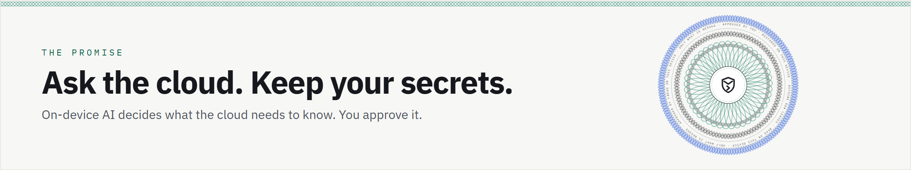
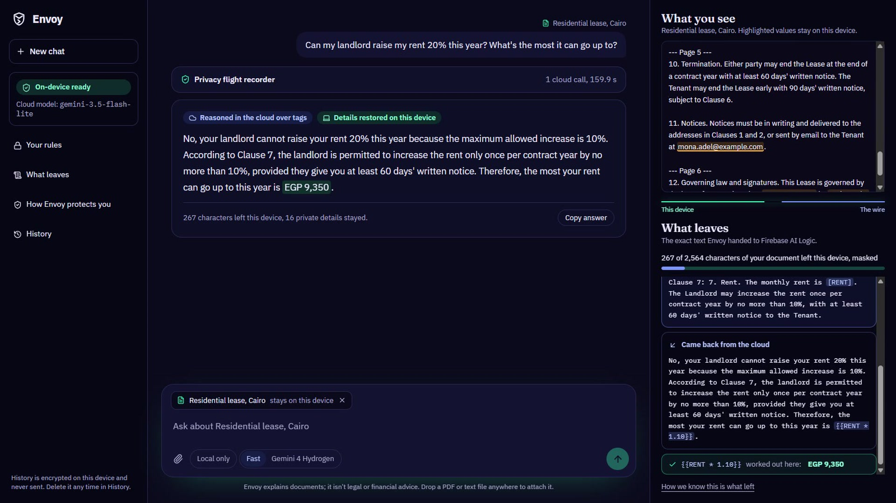
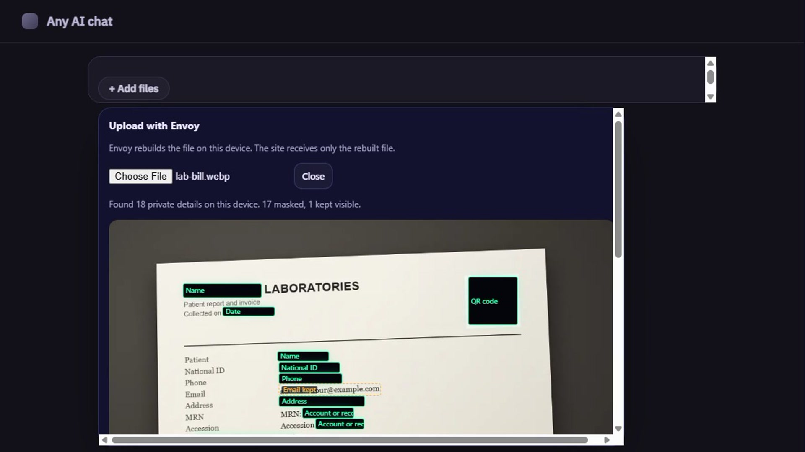
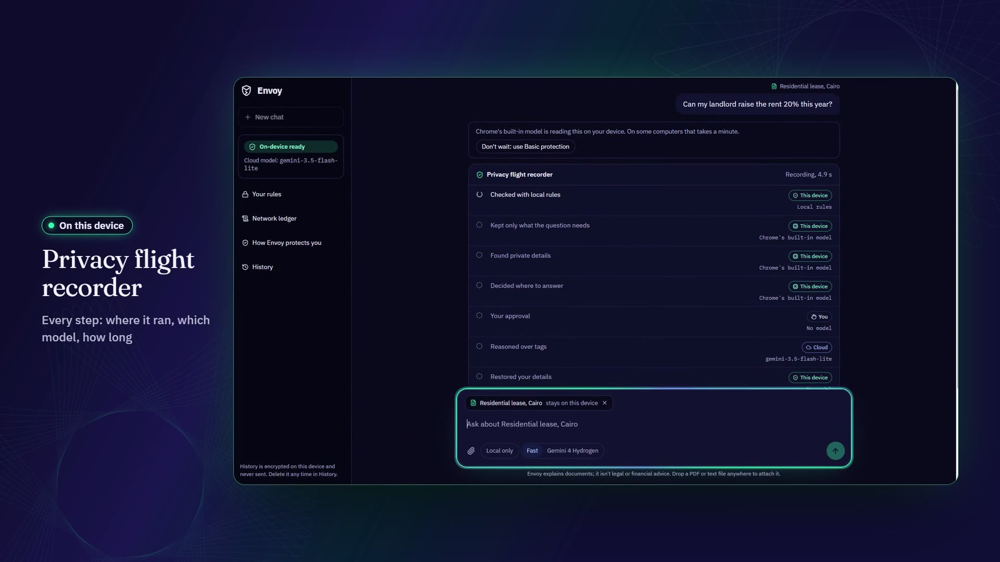

# Submission kit

Paste-ready fields and assets for the YouTube upload, the Chrome Web Store listing and the Devpost submission. Generated from one source, so the three stay consistent. Assets: `docs/submission/` (thumbnails, gallery) and `apps/extension/store/` (store icon, screenshots, tiles).

## Envoy YouTube upload

**Done: v9 is public at https://www.youtube.com/watch?v=n7IuGRGjLbU** (27 Nov, 2:57). It replaces v7 (ZO1DbGUI4Mk, 26 Nov); v8 was never published. The website embeds v9, and the README and Devpost link to it.

### 1. Upload the film

_studio.youtube.com → Create → Upload videos_

- Video: `F:\Projects\Envoy-wt\claude\video\out\envoy-demo-v9.mp4` (2:57, 1920×1080, 30 fps, -16 LUFS, 107 MB)
- Subtitles (optional, _Subtitles → Upload file → With timing_): `F:\Projects\Envoy-wt\claude\video\out\envoy-demo-v9.srt`

### 2. Details

_Details page_

- **Playlists:** None
- **Audience:** No, it's not made for kids

**Title** (95 / 100)

```text
Envoy: your private AI agent to the cloud | Firebase AI Logic hybrid inference | #BuildHybridAI
```

**Description**

```text
Envoy is your private AI agent to the cloud. Ask cloud AI about a lease, an offer letter or a lab report without handing over your private details.

Chrome's built-in model (Gemma 4, the model Gemini Nano 4 is built on) runs on your device through Firebase AI Logic hybrid inference. It finds names, IDs, accounts and amounts, keeps only the parts of the document your question needs, and turns private details into tags like [LANDLORD] and [RENT]. You see exactly what the cloud will see, and nothing is sent until you approve. Gemini in the cloud reasons over tags only, and Envoy puts your real details and the worked-out amounts back on your device. Every answer can come with a receipt signed in your browser.

The Chrome extension flags a paste with private details on the AI chat sites you choose, holds the send once, and swaps the details for tags; it masks photos (faces, IDs, QR codes) on your device before you upload them. The Android companion app runs the same engine in Kotlin with Firebase AI Logic.

Try it live, no sign-in: https://envoy-hybrid-ai.web.app
Watch a real Private-mode run (recorded on Gemma 4, no setup): https://envoy-hybrid-ai.web.app/app?recorded=1
Chrome extension: https://chrome.google.com/webstore/detail/ekmjefnebmjbeahkadaheapbgpgkabkd
Newest extension build and the Android app: https://github.com/hesham88/envoy/releases/tag/v0.2.0-android-extension
Code (Apache-2.0): https://github.com/hesham88/envoy

Chapters
0:00 Everything you paste into cloud AI leaves your device
0:20 Envoy: one clause leaves, the maths stays on your laptop, photos boxed
0:38 A real Private-mode session on Gemma 4 (Gemini Nano 4)
1:16 The guard, offline answers and a signed receipt
1:44 The Chrome extension holds a risky paste
1:57 Faces and IDs boxed in a photo, on the device
2:07 Envoy for Android
2:22 Built on Firebase, on purpose
2:37 Measured results

Measured on 36 test documents with Gemma 4 on 24 Nov 2026: every planted private detail masked, 0 raw details sent after the guard, and under a quarter of the document text sent (masked). A generated suite of 352 cases (27 Nov): 282 of 282 disguised leaks blocked, 0 of 70 harmless texts blocked. On a cloud NVIDIA L4 GPU: a median of 10.6 s per question, against 125 s on our 2018 laptop's CPU. Full results: https://github.com/hesham88/envoy/blob/main/docs/EVAL.md and https://github.com/hesham88/envoy/blob/main/docs/benchmarks/README.md

About this video: the web session is real, on a CPU-only laptop, with Gemini 3.5 Flash-Lite as the cloud model; long on-device waits are cut, and the film says where. The extension runs on a neutral stand-in chat page, and the Android app on the Android emulator. Everyone in it is fictional; the badge portrait is AI-generated. Narration: Chatterbox TTS (Resemble AI, MIT licence), an AI voice. Music and sound effects are original, made in code.

Made for the Firebase #BuildHybridAI 2026 hackathon.

#BuildHybridAI #FirebaseAILogic #Gemini
```

- Thumbnail (1280×720): `F:\Projects\Envoy-wt\claude\docs\submission\youtube-thumbnail.jpg` (Custom thumbnails need a phone-verified YouTube account.)

### 3. Show more

_Details page → Show more_

- **Altered content:** Yes. The footage is real screen recordings, but the sample staff badge shows a realistic portrait of a fictional person made with AI (Meta Muse Image), and the narration is an AI voice (Chatterbox TTS) that imitates no real person. Disclosing it costs nothing, and the description says both.
- **Video language:** English
- **Category:** Science & Technology
- **License:** Standard YouTube License
- **Allow embedding:** On (the Envoy website embeds the film)
- **Comments:** On

**Tags**

```text
Envoy, Firebase AI Logic, hybrid inference, Gemini Nano, Gemma 4, Chrome built-in AI, Prompt API, on-device AI, privacy, PII masking, Gemini, Chrome extension, Android, App Check, Remote Config, BuildHybridAI
```

### 4. Subtitles

_Video elements → Add subtitles → Upload file → With timing_

- English subtitles (.srt): `F:\Projects\Envoy-wt\claude\video\out\envoy-demo-v9.srt` (The rules accept English or English subtitles; this adds both.)

### 5. Publish and share the link

_Visibility → Public → Publish_

- **Visibility:** Public (the contest requires a public video)

Copy the video link and send it to Claude: it goes into the Envoy website (the "See it in under three minutes" section), the README, the Devpost video field and the Chrome Web Store promo video.

## Envoy Web Store listing

Fill the tabs in this order, then Save draft and Submit for review. Review can take several days, so submit as early as you can before 30 November.

### 1. Package

_Build → Package → Upload new package_

- Store package (version 0.1.3, uploaded 26 Nov): `F:\Projects\Envoy-wt\claude\apps\extension\envoy-extension-0.1.3-store.zip` (Holds key.pem so the store keeps the extension ID ekmjefnebmjbeahkadaheapbgpgkabkd. Upload it only to the Web Store.)

### 2. Store listing: product details

_Build → Store listing_

- **Title from package:** Envoy: private AI agent to the cloud (from the manifest, nothing to type)
- **Summary from package:** Ask cloud AI about private text. Envoy masks your details on your device, and you approve exactly what is sent.
- **Category:** Privacy & Security (Productivity also fits)
- **Language:** English
- **Mature content:** Off

**Description** (2301 / 16000)

```text
Envoy lets you use cloud AI with private documents and messages while sharing as little as possible.

Before anything leaves your computer, Envoy finds your private details on your device (names, emails, phone numbers, IDs, bank and account numbers, amounts, API keys, and words you mark as private) and swaps them for tags that keep their meaning, like [LANDLORD] or [RENT]. You see exactly what would be sent, and nothing is sent until you approve. When the answer comes back, your real details are put back on your device.

WHAT YOU GET
• Side panel: the Envoy chat, with a privacy flight recorder for every answer (where each step ran, which model, how long it took) and an approval card with the exact text that would leave. Choose Local only, Fast (Gemini 3.5 Flash-Lite) or Gemini 4 Hydrogen. Select text on any page, right-click, and choose Ask Envoy about this selection.
• On sites you switch on: a small chip on text boxes. Turn it on and private details light up; Replace swaps them for tags before you press send, and Undo puts your text back.
• Upload with Envoy: beside the chip on message boxes. Envoy rebuilds a file on your device before the site gets it: it masks text documents and PDFs, strips photo location and camera data, and lets you black out parts of an image. The rebuilt file goes into the site's message box.

HOW IT WORKS
Chrome's built-in AI runs on your device through Firebase AI Logic hybrid inference. Private steps run only on the device; only the reasoning, over tags, goes to Google's Gemini in the cloud, protected by Firebase App Check. Without the on-device model, Basic protection (local rules) still masks IDs, numbers, emails and accounts, and Envoy tells you which mode ran.

PRIVACY
• Off on every site until you switch it on: Envoy asks for access to one site at a time.
• Text-box checks and file rebuilding run on your computer; the extension doesn't send your text anywhere.
• Cloud questions go through the Envoy web app in the side panel, only after you approve the exact masked text.
• Chat history is off unless you turn it on; then it is encrypted on this computer.
Privacy policy: https://envoy-hybrid-ai.web.app/privacy

Open source (Apache-2.0): https://github.com/hesham88/envoy
Envoy explains documents; it isn't legal or financial advice.
```

### 3. Store listing: graphic assets

_Build → Store listing → Graphic assets_

- Store icon (128×128): `F:\Projects\Envoy-wt\claude\apps\extension\store\store-icon-128.png`
- Screenshot 1: findings on a text box: `F:\Projects\Envoy-wt\claude\apps\extension\store\screenshot-1-text-box.png`
- Screenshot 2: replaced with tags: `F:\Projects\Envoy-wt\claude\apps\extension\store\screenshot-2-replaced.png`
- Screenshot 3: Upload with Envoy: `F:\Projects\Envoy-wt\claude\apps\extension\store\screenshot-3-upload.png`
- Screenshot 4: side panel approval: `F:\Projects\Envoy-wt\claude\apps\extension\store\screenshot-4-approval.png`
- Screenshot 5: off until you switch it on: `F:\Projects\Envoy-wt\claude\apps\extension\store\screenshot-5-popup.png`
- Small promo tile (440×280): `F:\Projects\Envoy-wt\claude\apps\extension\store\promo-tile-440x280.png`
- Marquee promo tile (1400×560, optional): `F:\Projects\Envoy-wt\claude\apps\extension\store\marquee-1400x560.png`

Screenshots are 1280×800, 24-bit PNG with no transparency, rendered from the real 0.1.2 build. Upload them in this order. Global promo video: https://www.youtube.com/watch?v=n7IuGRGjLbU

### 4. Store listing: additional fields

_Build → Store listing → Additional fields_

- **Official URL:** Leave empty unless you verify envoy-hybrid-ai.web.app in Google Search Console (optional).

**Homepage URL** (31 / 2048)

```text
https://envoy-hybrid-ai.web.app
```

**Support URL** (40 / 2048)

```text
https://github.com/hesham88/envoy/issues
```

### 5. Privacy practices

_Build → Privacy_

- **Data usage: Website content:** Tick it. Only the text the user chooses to check, and the masked excerpt the user approves is sent to Google’s Gemini API through Firebase AI Logic to answer the question.
- **Data usage: everything else:** Leave unticked (personally identifiable, health, financial, authentication, personal communications, location, web history, user activity). Envoy masks those details before anything is sent and stores nothing on a server.
- **Certifications:** Tick all three: not sold; not used or transferred for unrelated purposes; not used for creditworthiness or lending.

**Single purpose** (132 / 1000)

```text
Helps people use cloud AI with private text by masking their private details on their device and sending only the text they approve.
```

**sidePanel justification** (44 / 1000)

```text
Shows the Envoy chat in Chrome’s side panel.
```

**contextMenus justification** (87 / 1000)

```text
Adds "Ask Envoy about this selection", which hands the selected text to the side panel.
```

**storage justification** (102 / 1000)

```text
Keeps the user’s own privacy rules and the list of sites they switched Envoy on for, on this computer.
```

**scripting justification** (95 / 1000)

```text
Adds Envoy’s text-box and upload helpers to the sites the user switches on, one site at a time.
```

**offscreen justification** (168 / 1000, updated for 0.1.3: the offscreen page also reads photos)

```text
Runs Envoy's on-device checks in an extension page instead of inside the website: the AI check for text boxes, and reading text and barcodes in photos the user uploads.
```

**activeTab justification** (140 / 1000)

```text
When the user switches Envoy on for the current site from the toolbar popup, adds the helpers to that open tab right away, without a reload.
```

**Host permission justification** (163 / 1000)

```text
Optional host access is requested only when the user switches Envoy on for a site, so the text-box and upload helpers can run there. No site is enabled by default.
```

**Remote code** (no field on the Privacy page as of 26 Nov 2026: the store checks the package itself; 0.1.2 was rejected for Firebase script URLs in the bundle, fixed in 0.1.3, `docs/SECURITY.md`). If a reviewer asks:

```text
All code ships in the package. The side panel shows Envoy’s own web app (https://envoy-hybrid-ai.web.app) in a frame so cloud requests are protected by Firebase App Check; no remote script runs in the extension.
```

**Privacy policy URL** (39 / 2048)

```text
https://envoy-hybrid-ai.web.app/privacy
```

### 6. Distribution

_Build → Distribution_

- **Payments:** Free of charge
- **Visibility:** Public (judges can find and install it). Unlisted also works if you prefer only people with the link.
- **Regions:** All regions

### 7. Test instructions for the reviewer

_Build → Test instructions_

**Test instructions** (938 / 5000)

```text
No account or login is needed. All sample details are fictional.
1. Click the Envoy toolbar icon on any website with a text box and switch on "Envoy on this site". Chrome asks for access to that one site.
2. Click in a text box: a small "Envoy off" chip appears. Click it to turn protection on, then type: Hi, I'm Mona Adel (mona.adel@example.com, +20 100 555 0192), my bank account number 1010192316. The details light up. Press Replace to swap them for tags; Undo puts the text back.
3. Click "Upload with Envoy" beside the chip, choose a .txt file or a photo (the sample photo is at https://envoy-hybrid-ai.web.app/samples/lab-bill.webp): Envoy reads the photo on the device and masks every private detail it finds, QR code included; press a mask to keep that part visible, then press Send. Envoy rebuilds the file on the device and hands it to the site.
4. Open the side panel (toolbar icon → Open Envoy panel), choose "Try the sample lease", and press Approve and send to see a cloud answer over tags.
Chrome 139 or later. Chrome's on-device AI is optional: without it Envoy uses Basic protection (local rules) and says so.
```

Then Save draft and Submit for review.

## Envoy Devpost submission

Devpost has four pages. You can edit the submission until the deadline (Mon 30 Nov, 2:00 PM PT), so submit early and refine. Upload the film to YouTube first: its link goes on page 2.

### 1. Project overview

_Page 1: General info_

**Project name** (41 / 60)

```text
Envoy: your private AI agent to the cloud
```

**Elevator pitch** (198 / 200)

```text
Ask the cloud, keep your secrets. Chrome’s on-device AI turns your private details into tags and sends only what your question needs. Gemini reasons over tags; your details come back on your device.
```

- Thumbnail (3:2, 1500×1000): `F:\Projects\Envoy-wt\claude\docs\submission\devpost-thumbnail.png`

### 2. Project story

_Page 2: About the project (Markdown)_

**About the project** (v2, 27 Nov: Markdown with tables and images. Check the editor preview: if Devpost shows a table as raw pipes, turn that table into a list.)

```text


**Try it, no sign-in:** [envoy-hybrid-ai.web.app](https://envoy-hybrid-ai.web.app) · [recorded Private-mode run](https://envoy-hybrid-ai.web.app/app?recorded=1) · [code](https://github.com/hesham88/envoy) · [Chrome Web Store](https://chrome.google.com/webstore/detail/ekmjefnebmjbeahkadaheapbgpgkabkd) · [newest extension and Android app](https://github.com/hesham88/envoy/releases/tag/v0.2.0-android-extension)

## At a glance

| What we measured | Result |
| --- | --- |
| Document text that reaches the cloud (Private mode, 36 documents) | **23.2%**, every detail a tag |
| Planted private details masked / raw details sent | **263 of 263** / **0** |
| Generated adversarial suite (352 cases) | **282 of 282** leaks blocked, **0 of 70** harmless texts blocked |
| Private details boxed in photos, on the device | **203 of 208** (97.6%) |
| Median time per question, Gemma 4 on the device | 125 s on a 2018 laptop CPU, **10.6 s on an NVIDIA L4 GPU** |
| Sign-ins, accounts, servers of our own | **0** |

Every number names its model, date and sample size in [EVAL.md](https://github.com/hesham88/envoy/blob/main/docs/EVAL.md) and [benchmarks](https://github.com/hesham88/envoy/blob/main/docs/benchmarks/README.md).

## Inspiration
People paste leases, offer letters, lab results and config files full of keys into cloud AI every day, and every name, ID, account and amount goes with them. Most of the time the cloud doesn't need any of that to help. We wanted the cloud's reasoning without handing over the details.

## What it does
Envoy is your private AI agent to the cloud. You ask a question about a private document, or type a message with private details. Chrome's built-in model, on your device, finds the private details, keeps only the parts the question needs, and swaps names, IDs, accounts and amounts for tags that keep their meaning, like `[LANDLORD]` and `[RENT]`. You see exactly what the cloud will see and approve it. Gemini reasons over tags only and writes any maths as an expression, such as `{{RENT * 1.10}}`; Envoy works out the real amount and puts your details back, on your device. Questions the document answers directly never leave the device.



- **Privacy flight recorder:** every step, where it ran, which model, how long it took, and the browser's own count of requests to the AI endpoint.
- **Approval card:** the exact excerpt, editable. A guard blocks raw details even when spaced out, encoded or disguised.
- **Signed receipt:** one click saves what left the device, signed in your browser with WebCrypto (ECDSA P-256); a script verifies it.
- **Any document:** PDF, Word, Excel, PowerPoint and photos, read on the device. In photos, text, barcodes, QR codes and **faces** are boxed before you press anything, and location data is removed.
- **Beyond English formats:** Spanish DNI/NIE, French NIR and phone numbers, European dates and amounts, with their checksums.
- **Voice, on the device:** dictation only with Chrome's on-device speech recognition; answers read by a voice on your computer, never a network voice.
- **Offline, then online:** with no network, Envoy keeps answering on the device; a question for the cloud can wait, approved and masked, and goes once you're back.
- **Chrome extension:** on the AI chat sites you switch on, a paste with a private detail is flagged and Enter is held once so you can replace it with tags. Upload with Envoy rebuilds files on the device before a site gets them.
- **Android companion:** the same engine in Kotlin, with `firebase-ai` and `firebase-ai-ondevice`, checked against the web engine by parity tests in CI.
- **For organisations:** a policy pack of masking rules (codenames, client IDs) published once in Remote Config reaches every user without a redeploy.



## How we built it: Firebase, on purpose
| Firebase piece | What it does in Envoy |
| --- | --- |
| **AI Logic hybrid inference** | One `GenerativeModel` per step, each with its own `InferenceMode`. Finding details, choosing clauses, routing and local answers use `ONLY_ON_DEVICE`. Only the reasoning step reaches the cloud: Gemini 3.5 Flash-Lite (`PREFER_IN_CLOUD`), or Gemini 4 Hydrogen (`ONLY_IN_CLOUD`) with Flash-Lite as its fallback. One JSON Schema drives structured output on both sides. |
| **AI Logic on Android** | `firebase-ai` + `firebase-ai-ondevice`: `checkStatus()` before each private step, `inferenceSource` checked after it. |
| **App Check** | Enforced: reCAPTCHA Enterprise on the web, Play Integrity on Android, limited-use tokens. |
| **Remote Config** | The cloud models, the on-device prompt version and an organisation's policy pack, without a redeploy. |
| **Hosting** | The app, deployed by CI from `main`, with a strict CSP (no CDN, no `unsafe-eval`). |

Left out on purpose: Authentication and Firestore. Envoy has no accounts and stores nothing about you; history is off unless you turn it on, and it stays encrypted in your browser.

**The device guard.** An open SDK report (firebase-js-sdk #10635) describes `ONLY_ON_DEVICE` requests reaching the cloud when Chrome's model is missing. We haven't seen it ourselves, but a privacy promise shouldn't rest on one layer. So every private step is checked twice: availability before it runs, and `inferenceSource === ON_DEVICE` after it, with a network tripwire on the AI Logic endpoint in between. A blocked request stops the run; it never falls back to the cloud. On-device models can only add detections, never remove what the local rules found.



## Measured
- **Text documents (24 Nov, Gemma 4 `gemma4_component` 2026.11.3.1140):** 36 documents and 263 planted details. Every detail was masked, 0 raw details were sent after the guard, and 23.2% of the document text was sent, masked. Answer quality on 20 questions: Gemini 3.5 Flash-Lite, grading against an answer from the whole document, scored Private mode at 97.5%. Because it also wrote some answers, every answer was also checked by the team against its document: Private mode 95%, Basic protection 97.5%.
- **Adversarial suite (27 Nov):** 352 generated cases ([source](https://github.com/hesham88/envoy/blob/main/packages/core/src/redteam-suite.ts), [results](https://github.com/hesham88/envoy/blob/main/docs/benchmarks/redteam-suite.json)). Each of 20 fictional values is written every way that fits: spaced, zero-width characters, lookalike letters, full-width and Arabic-Indic digits, base64, reversed, number words, URL-encoded, split across lines. 282 of 282 leaks were blocked and 0 of 70 harmless texts. It tests the outbound guard against values Envoy already knows, not detection recall, and it isn't held out: it found two gaps (URL encoding, names spelled letter by letter), which we fixed before this result.
- **Photos (26 Nov):** six of the documents in four looks (serif, sans, tilted, low contrast). On-device OCR boxed 203 of 208 private details (97.6%), about 1.4 s a page.
- **Faster hardware (27 Nov):** the same 17 sample questions, the same pipeline and model flag, on a cloud NVIDIA L4 GPU: median 10.6 s, against 125 s on our 2018 laptop's CPU (2.7 to 3.8 s for short documents), all 17 in Private mode with 0 cloud calls. Run in a separate Google Cloud project, deleted afterwards ([method and logs](https://github.com/hesham88/envoy/blob/main/docs/benchmarks/README.md)).
- **Every commit:** 536 unit tests and Android unit and parity tests in CI, and an extension end-to-end suite on the real build (49 of 49).

## Challenges we ran into
- **Trusting "on device".** The SDK report above meant a "private" step could, in principle, reach the cloud; the device guard and its tests make the boundary checkable.
- **CPU-only latency.** On our laptop the on-device steps take one to two and a half minutes. We added a cache, honest progress and a "Don't wait" option, and then measured a GPU: about 11 s.
- **A model that crashed.** Chrome's earlier default model ran all 36 cases on 22 November but crashed after 12 the next day, so we removed its numbers rather than publish stale ones.
- **A library that phoned home.** The face detector's library sends usage logs every minute. We remove that code at build time, and the build fails if it changes.
- **The Chrome Web Store.** 0.1.2 was rejected for "remotely hosted code": script URLs in the bundled Firebase SDK that Envoy never loads. 0.1.3 removes them at build time, and every build checks.

## Accomplishments that we're proud of
0 raw details sent on our benchmark, 282 of 282 disguised leaks blocked, about a quarter of the document sent, the same engine on the web, in the extension and on Android, and a privacy boundary people can actually see: the recorder, the approval card, What leaves, and a receipt they can keep.

## What we learned
Small on-device models are good at finding and trimming but weaker at arithmetic, so the cloud should reason over tags while the device does the maths with the real values. Measuring with the real pipeline, and dating every number, kept us honest.

## Known limits
- Envoy masks what it detects. It doesn't promise that nothing about you can be inferred: details that aren't identifying on their own (a city, an employer) can narrow things down together. You can hide any sentence in the approval card.
- The on-device model's prompts and the app are in English; the Spanish, French and German formats are rules. Handwriting isn't read.
- The Android app has run on the emulator (Basic protection and a real App Check-protected cloud answer), not yet on a phone with Gemini Nano.
- The extension's send check catches Enter; a click on a site's own Send button goes through.
- The GPU run didn't record the on-device model's component version.

## What's next
A held-out evaluation set written by someone other than the rule authors, more languages for the on-device prompts, Android on a phone with Gemini Nano, and a send check that also covers the site's own Send button.

## Q&A
**Does my document go to the cloud?** No. Only the excerpt you approve goes, with every detected detail as a tag. You can read it, edit it, or stop.

**What if Chrome has no on-device model?** Envoy says so and uses Basic protection: local rules mask the same details, and it sends the whole text, masked, because it can't tell which parts the question needs.

**How do I know a private step really ran on my device?** The flight recorder shows where each step ran, the browser's own count of AI requests, and the network ledger (`?inspect=1`) lists every request. The signed receipt records what left.

**Do I need an account?** No. There's no sign-in and no server of ours; the only network calls go to Firebase.

**Which on-device model?** Measured on Gemma 4, the model Gemini Nano 4 is built on, in Chrome. Firebase AI Logic runs on whichever model Chrome provides.

**Can I try it without the model?** Yes: the [recorded run](https://envoy-hybrid-ai.web.app/app?recorded=1) replays a real Gemma 4 run, word for word, labelled as a recording.

## Built during the submission period, and with what
The repository starts on 22 November 2026; no code predates it.

- **Building:** Claude Code (Anthropic) built the core, the AI layer, the web app, the extension, the Android app and the visual identity. Antigravity (Google, Gemini) built the evaluation harness. Both used the Firebase agent skills. Meta Muse Wonder (Meta) did the extension's early development; on 22 November Claude Code (Claude Opus) and Antigravity's Gemini Neon coding agent took it over.
- **Reviewing:** Codex Astra (OpenAI), Claude and Antigravity were also used as outside reviewers, playing the judges.
- **Media:** the demo film's narration is Chatterbox TTS (Resemble AI, MIT licence). The art is drawn in code, except the fictional portrait on the sample staff badge, which was made with Meta Muse Image.
- **Libraries:** Firebase JS and Android SDKs, React, Vite, Tailwind CSS, pdf.js, Tesseract.js, zxing-wasm and MediaPipe (self-hosted, for photos), Jetpack Compose, ML Kit text recognition, Lucide icons, Fraunces and IBM Plex fonts.
- **Influences:** inspired by PAPILLON (Li et al., NAACL 2025), and designed with Google PAIR's People + AI Guidebook.
```

### 3. Built with, links and media

_Page 2: Built with, Try it out, Project media_

- **Demo video URL:** https://www.youtube.com/watch?v=n7IuGRGjLbU

**Built with (type each, press Enter)**

```text
firebase-ai-logic, firebase, firebase-app-check, firebase-remote-config, firebase-hosting, gemini, gemini-nano, gemma, chrome-built-in-ai, prompt-api, chrome-extension, recaptcha-enterprise, react, typescript, vite, tailwindcss, pdf.js, tesseract.js, zxing-wasm, webassembly, playwright, vitest, github-actions, node.js, android, kotlin, jetpack-compose, firebase-ai-ondevice, play-integrity, ml-kit, mediapipe, webcrypto
```

**"Try it out" link 1**

```text
https://envoy-hybrid-ai.web.app/app?recorded=1
```

**"Try it out" link 2**

```text
https://github.com/hesham88/envoy
```

**"Try it out" link 3**

```text
https://envoy-hybrid-ai.web.app
```

**"Try it out" link 4** (the Chrome Web Store)

```text
https://chrome.google.com/webstore/detail/ekmjefnebmjbeahkadaheapbgpgkabkd
```

**"Try it out" link 5** (the newest extension build and the Android app)

```text
https://github.com/hesham88/envoy/releases/tag/v0.2.0-android-extension
```

- Gallery 1: private details become tags: `F:\Projects\Envoy-wt\claude\docs\submission\gallery-1-tags.jpg`
- Gallery 2: privacy flight recorder: `F:\Projects\Envoy-wt\claude\docs\submission\gallery-2-recorder.jpg`
- Gallery 3: you approve what leaves: `F:\Projects\Envoy-wt\claude\docs\submission\gallery-3-approval.jpg`
- Gallery 4: the guard blocks raw details: `F:\Projects\Envoy-wt\claude\docs\submission\gallery-4-guard.jpg`
- Gallery 5: the Chrome extension: `F:\Projects\Envoy-wt\claude\docs\submission\gallery-5-extension.jpg`
- Gallery 6: Upload with Envoy: `F:\Projects\Envoy-wt\claude\docs\submission\gallery-6-upload.jpg`
- Gallery 7: measured, not promised: `F:\Projects\Envoy-wt\claude\docs\submission\gallery-7-measured.jpg`
- Gallery 8: what you see, and what leaves (the cloud's {{RENT * 1.10}} worked out on the device): `F:\Projects\Envoy-wt\claude\docs\submission\gallery-8-what-leaves.jpg`
- Gallery 9: a photo masked on the device, one detail kept: `F:\Projects\Envoy-wt\claude\docs\submission\gallery-9-photo-masks.jpg`
- Gallery 10: Android, what the cloud will see: `F:\Projects\Envoy-wt\claude\docs\submission\android-excerpt.jpg`
- Gallery 11: Android, the answer with real values restored on the phone: `F:\Projects\Envoy-wt\claude\docs\submission\android-answer.jpg`

### 4. Additional info for judges

_Page 3 (not public)_

- **Submitter type:** Individual
- **Country of residence:** Yours
- **Organization name:** Leave empty
- **Project start date:** 11-22-26
- **New or existing?:** New: the repository starts on 22 November 2026, and no code predates it.
- **Platform(s):** Web (Chrome). If the form allows a second platform, the owner decides whether to tick Android too (the companion app is in the release; it has run on the emulator only).
- **Eligibility (three boxes):** Yours to confirm: age of majority, eligible jurisdiction, and not an employee, representative or agent of the sponsors or administrator.

**How it meets the main technology requirement**

```text
Envoy calls Firebase AI Logic (firebase/ai) at runtime with hybrid inference in Chrome. Each pipeline step is its own GenerativeModel with its own InferenceMode: finding private details, choosing clauses, routing and local answers run ONLY_ON_DEVICE on Chrome's built-in model (measured on Gemma 4, the model Gemini Nano 4 is built on); only the reasoning step goes to the cloud (Gemini 3.5 Flash-Lite with PREFER_IN_CLOUD by default, or Gemini 4 Hydrogen with ONLY_IN_CLOUD and Flash-Lite as fallback). A device guard checks availability, trips on any network call to the AI Logic endpoint during a private step, and asserts inferenceSource === ON_DEVICE (firebase-js-sdk #10635). Structured output on both sides comes from one JSON Schema. App Check (reCAPTCHA Enterprise, limited-use tokens) is enforced, Remote Config chooses the cloud models, and the app runs on Firebase Hosting. The Android companion uses Firebase AI Logic for Android (firebase-ai with firebase-ai-ondevice): FirebaseAIOnDevice.checkStatus() before each private step and response.inferenceSource checked after it, with App Check (Play Integrity). Code: packages/ai/src/firebase.ts, models.ts, pipeline.ts and device-guard.ts; android/app/src/main/java/app/envoy/hybrid/ai/EnvoyAi.kt.
```

**Working demo URL**

```text
https://envoy-hybrid-ai.web.app
```

**Testing instructions**

```text
No login or credentials are needed. The sample lease and everyone in it are fictional.
Before you start (Chrome setup): any desktop Chrome runs this test. Without Chrome's on-device model, Envoy uses Basic protection (local rules) and says so. Private mode needs desktop Chrome with the built-in model: check chrome://on-device-internals, or follow https://github.com/hesham88/envoy/blob/main/docs/GEMMA4_SETUP.md for our exact Gemma 4 setup (Chrome 158, one developer-trial flag, about 10 minutes plus the model download). Private mode was measured on Gemma 4 (Gemini Nano 4); on Chrome's default model, results may vary. On-device steps can take about a minute on a CPU-only laptop.
1. Open https://envoy-hybrid-ai.web.app/app?sample=lease and ask: "Can my landlord raise the rent 20% this year?"
2. Watch the flight recorder: each step says where it ran (this device or the cloud), which model and how long.
3. Read "What the cloud will see": names, IDs, the IBAN and the rent are tags. Approve to get the answer, with your real numbers put back on your device. Add ?inspect=1 to the address to see the network ledger.
4. No on-device model on your computer? Open https://envoy-hybrid-ai.web.app/app?recorded=1 to watch a real, recorded Private-mode run on Gemma 4, labelled as a recording, with the real step times.
5. The Chrome extension (optional): install it from the Chrome Web Store, https://chrome.google.com/webstore/detail/ekmjefnebmjbeahkadaheapbgpgkabkd, or get the newest build (0.1.4) and the Android app from https://github.com/hesham88/envoy/releases/tag/v0.2.0-android-extension. With the newest build, load the extension unpacked from chrome://extensions, turn it on for a site, paste a message with an email address into its text box, and press Enter: Envoy holds the send once and shows what it found.
```

**Open-source license URL**

```text
https://github.com/hesham88/envoy/blob/main/LICENSE
```

### 5. Submit

_Page 4_

- **Terms:** Tick "I, and all of my team members, have read and agree…" after reading the Official Rules.
- **Deadline:** Mon 30 Nov 2026, 2:00 PM PT (midnight Tue 1 Dec in Cairo). Commits after the deadline are not judged.

The disclosure above names every AI tool that built part of Envoy: Claude Code, Antigravity (Gemini Argon and Neon agents) and Meta Muse Wonder.
